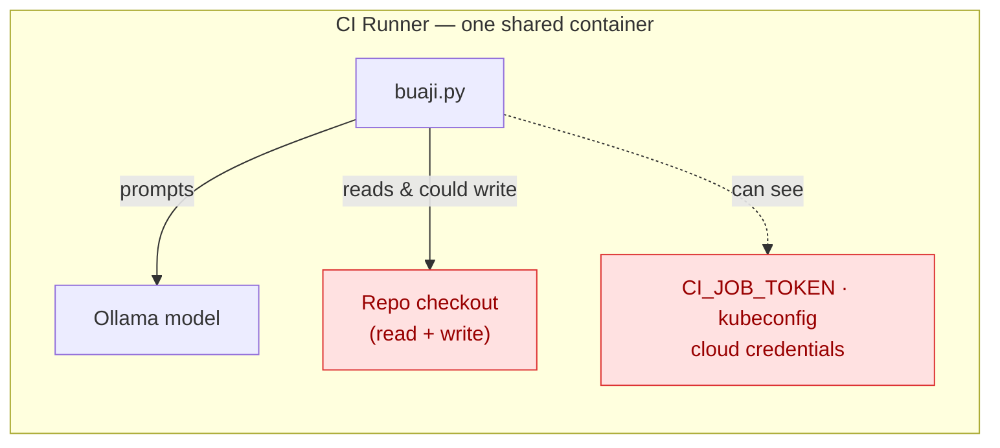
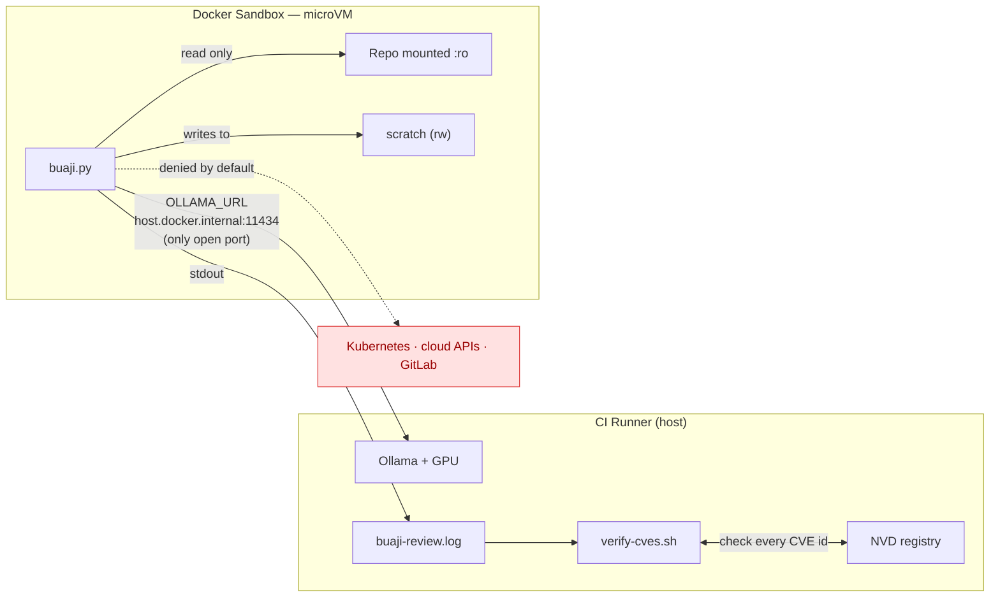
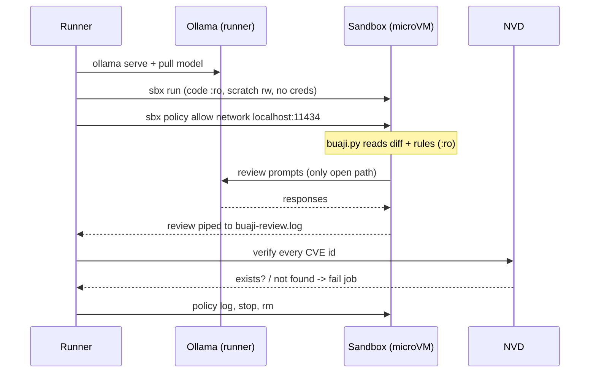

# BuaJi 🧐 — AI code review, contained

BuaJi is a small, self-hosted AI code reviewer for CI/CD pipelines. On every
push it reads what changed and writes a first-pass review into the pipeline —
the same kind of comment a human teammate would leave before a person looks at
the change.

> In India, your *bua* is your father's sister — the relative who inspects
> everything you do and always finds something wrong with it. A fitting name
> for a code reviewer.

BuaJi runs local models through **Ollama**, so the code it reads never leaves
your infrastructure. This repo also shows how to **contain** BuaJi inside a
[Docker Sandbox](https://docs.docker.com/ai/sandboxes/) so that its read-only
promise is enforced by the environment, not by a convention in the script.

This is the companion code for the blog *"Coding Agent Horror Stories: The CVE
That Did Not Exist."* The story's point: a read-only agent that only writes
comments can still get your cluster taken down — because it can *tell a human*
to run commands it was never allowed to run itself. Containment handles one half
of that; a CVE-verification gate and a careful reader handle the other.

---

## What BuaJi does

- Reads review rules from [`rules.md`](rules.md)
- Finds changed files with `git diff HEAD^ HEAD --name-only`
- Sends each changed Go file + each rule to a local Ollama model
- Prints a pass/fail-style review to the CI log

It **cannot** run `terraform apply`, `kubectl apply`, or push a commit. In the
sandboxed setup it also cannot reach the cluster, your cloud APIs, or GitLab —
and it cannot write to your source at all.

---

## Architecture

### Before: everything in one container

Originally the job ran everything — the model, the script, the checkout, and
every CI variable including `CI_JOB_TOKEN` — in a single container. BuaJi was
"read-only" only because the script happened not to write anything. The
restriction lived in habit, one rushed change away from disappearing.



### After: BuaJi in a Docker Sandbox

Now the model stays on the runner next to the GPU, and BuaJi moves into an
isolated microVM that can read the code, talk to the model, and nothing else.
The code is mounted **read-only**, no credentials are passed in, and exactly one
network path — to the model — is open. Everything BuaJi writes is just text,
and that text is checked on the way out.



### Pipeline flow



---

## Repository layout

| File | Role |
|------|------|
| [`buaji.py`](buaji.py) | The reviewer. Reads `OLLAMA_URL` (default `http://localhost:11434`) so it can reach the model from inside a sandbox. |
| [`rules.md`](rules.md) | One review rule per line. Edit to match your standards. |
| [`buaji.sandbox.Dockerfile`](buaji.sandbox.Dockerfile) | Sandbox template: `docker/sandbox-templates:shell` + `python3`, `python3-requests`, `git` baked in, so the sandbox needs no internet of its own. |
| [`scripts/verify-cves.sh`](scripts/verify-cves.sh) | Fails the review if it cites a CVE that does not exist in NVD. |
| [`.gitlab-ci.yml`](.gitlab-ci.yml) | The full pipeline. The `buaji` job runs the review inside an `sbx` microVM. |
| `main.go`, `go.mod` | A tiny Go service — the thing being reviewed. |

---

## Running it

### Locally (unsandboxed)

```bash
ollama serve &
ollama pull gemma
LLM=gemma python3 buaji.py        # reviews .go files changed in HEAD^..HEAD
```

### In CI, inside a Docker Sandbox

The `buaji` job in [`.gitlab-ci.yml`](.gitlab-ci.yml) does this on a self-hosted
runner (GPU for Ollama, KVM for the microVMs). The moving parts:

1. **Point BuaJi at the model via env.** Inside a sandbox `localhost` is the
   sandbox itself, so `buaji.py` reads `OLLAMA_URL` and defaults to the old value.
2. **Bake dependencies into a template once** (`buaji.sandbox.Dockerfile`),
   push it to your registry, store the name in `BUAJI_TEMPLATE`.
3. **Keep the model on the runner** next to the GPU.
4. **Create the sandbox with the code mounted read-only:**
   ```bash
   sbx run -d --name "$SBX_NAME" -t "$BUAJI_TEMPLATE" \
     shell "$CI_BUILDS_DIR/buaji-scratch" "$CI_PROJECT_DIR:ro"
   ```
   No GitLab token, no kubeconfig, no cloud credentials are passed in.
5. **Open exactly one network path — to the model:**
   ```bash
   sbx policy allow network --sandbox "$SBX_NAME" localhost:11434
   ```
6. **Run the review**, pointing it at the runner's Ollama:
   ```bash
   sbx exec -w "$CI_PROJECT_DIR" \
     -e LLM="$LLM" -e OLLAMA_URL=http://host.docker.internal:11434 \
     "$SBX_NAME" python3 buaji.py | tee buaji-review.log
   ```
7. **Verify every CVE** the review mentions (see below).
8. **Audit and clean up:** `sbx policy log` shows every host BuaJi tried to
   reach; a healthy run shows only the model on port `11434`. Then `sbx stop`
   and `sbx rm`.

---

## The CVE gate

A fabricated security finding often hangs its whole argument on a single CVE
number — and a CVE number is one of the easiest things in security to verify.
[`scripts/verify-cves.sh`](scripts/verify-cves.sh) greps every `CVE-…` id out of
the review and looks each one up in the public NVD registry. If any do not
exist, it fails the job:

```bash
./scripts/verify-cves.sh buaji-review.log
# ⚠️ BuaJi output mentions CVE IDs that do not exist: CVE-2026-99999
# ⚠️ Treat this review as unverified. Do not run any commands it suggests.
```

It runs on the runner, outside the sandbox, so BuaJi cannot skip it. It won't
catch every invented detail (a fake Kubernetes resource name, say), but it
catches the one that holds most fabricated reports together.

---

## What the sandbox does — and does not — protect

A sandbox is not a fact-checker. **It will not stop a model from making things
up.** What it changes is what that fabricated output can *do*: the microVM has
its own kernel and filesystem, the code is read-only, and the network denies
everything except the one path you opened. The read-only rule stops being
something a person has to remember and becomes a property of the environment.

Two things it does **not** handle, worth stating plainly:

- **The human who reads the output.** No sandbox makes a review accurate.
  Treat an agent's security finding as a hypothesis, label it clearly as agent
  output, and never run agent-written remediation without reviewing it first.
- **Your runner's defaults.** "Denies everything by default" assumes the
  runner's default network policy is **deny-all / locked-down**. On a balanced
  or open policy, common dev hosts stay reachable regardless of this job — so
  set the runner default to deny-all and let this job open only `localhost:11434`.
  Likewise, if the operator has global `sbx secret`s configured, placeholder
  credential env vars may be injected; raw values never enter the VM and the
  network policy still blocks the services they belong to, but a clean CI runner
  (with no personal secrets) is the intended environment.

---

## Credits

Built by Pratik Kumar Singh. Sandboxing write-up and hardening by the Docker
team. Companion to the *AI Coding Agent Horror Stories* series.
